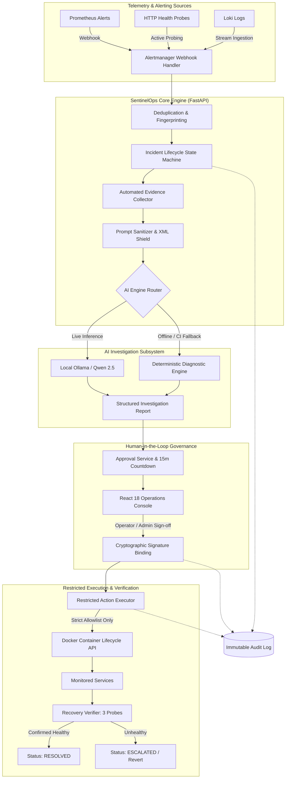

# SentinelOps AI

> Autonomous AI-powered IT Incident Management Platform.

<p align="center">
  <strong>Autonomous AI-Powered IT Incident Management Platform</strong><br>
  <em>Detect, Investigate, Approve, Remediate, and Verify Operational Failures with Guardrailed AI</em>
</p>

SentinelOps AI continuously monitors application infrastructure, detects operational failures, gathers diagnostic evidence (metrics, logs, health checks), investigates incidents with structured local AI inference, identifies probable root causes, recommends risk-classified remediation actions, enforces strict human approval gates, executes allowlisted remediation safely, verifies service recovery, and maintains an immutable audit trail.

<p align="center">
  
  
  
  
  
  
</p>

---

## Overview

**SentinelOps AI** is an autonomous IT Incident Management platform engineered for local-first, self-hosted reliability. It continuously listens to monitoring infrastructure, detects operational failures, gathers diagnostic evidence (Prometheus metrics, Loki log streams, live HTTP probes), investigates incidents using structured local AI inference, identifies probable root causes, recommends risk-classified remediation actions, enforces human-in-the-loop approval, executes allowlisted actions safely without subshell invocation, automatically verifies service recovery, and maintains an immutable audit trail.

---

## System Architecture



---

## Key Capabilities

- **Automated Detection & Ingestion:** Native Alertmanager webhook ingestion with fingerprint-based deduplication.
- **Contextual Evidence Gathering:** Correlates Prometheus metrics, Loki log streams, and live HTTP health probes.
- **Evidence-Backed AI Investigation:** Structured local AI inference (Ollama) producing hypotheses citing concrete evidence IDs.
- **Human-in-the-Loop Approval:** Cryptographic action signature verification with 15-minute expiration window before any infrastructure mutation.
- **Restricted Remediation Execution:** Strict allowlisted actions (`container.restart`, `health_check`); zero arbitrary shell execution.
- **Automated Recovery Verification:** Multi-step post-remediation health check polling before transitioning to `RESOLVED`.
- **Immutable Audit Logging:** Tamper-evident logging of all security-relevant and state-altering actions.

1. **Multi-Source Telemetry Ingestion (FR-01):** Alertmanager webhooks, continuous HTTP health probes, Prometheus metrics scraping, and Loki log tailing.
2. **Fingerprint Deduplication (FR-02):** Sliding 300-second deduplication window grouping recurring alert spikes into single incidents.
3. **11-State Incident Lifecycle (FR-03):** Strictly guarded state transitions (`TRIGGERED` → `INVESTIGATING` → `ROOT_CAUSE_IDENTIFIED` → `AWAITING_APPROVAL` → `REMEDIATING` → `VERIFYING` → `RESOLVED` / `ESCALATED`).
4. **Automated Evidence Gathering (FR-04):** Immediate snapshotting of error rates, container status, and recent log traces attached as immutable evidence items.
5. **Evidence-Grounded AI Investigation (FR-05):** Local inference via Ollama (`qwen2.5:7b`) with prompt injection quarantining (`<untrusted_evidence>` XML boundaries). Generates hypotheses that cite concrete evidence IDs with fallback to a deterministic diagnostic engine.
6. **Strict Allowlisting & Parameter Binding (FR-06, FR-08):** Zero arbitrary shell execution (`shell=False`). Only pre-approved actions (`service.restart_container`, `service.health_check`) are permitted with regex validation.
7. **Human-in-the-Loop Approvals (FR-07):** SHA-256 signature binding of `action_id + target + parameters` with a 15-minute expiration countdown.
8. **Automated Post-Remediation Verification (FR-09):** Exponential backoff health verification polling before incident closure.
9. **Role-Based Access Control (FR-11):** Native Bcrypt hashing and PyJWT tokens enforcing `admin`, `operator`, and `viewer` role privileges.
10. **Operations Console (FR-12):** Responsive React 18 dashboard with real-time incident filtering, evidence inspection cards, approval modals, and audit trail viewer.

---

## Tech Stack

- **Backend:** Python 3.12+, FastAPI, Pydantic v2, Motor (MongoDB async), Redis
- **Frontend:** React 18, TypeScript, Vite, Tailwind CSS, Lucide React
- **Persistence:** MongoDB 7.0 (Collections: users, services, incidents, evidence, investigations, approvals, remediation_executions, audit_logs)
- **Coordination:** Redis 7.0 (Deduplication locks, rate limiting)
- **AI Subsystem:** Ollama local inference (`qwen2.5` / `llama3.2`) with pluggable provider architecture
- **Telemetry:** Prometheus, Alertmanager, Grafana Loki
- **Testing:** Pytest, HTTPX, Playwright E2E| Layer                     | Technology                                       | Purpose                                                                       |
  | ------------------------- | ------------------------------------------------ | ----------------------------------------------------------------------------- |
  | **Backend API**     | Python 3.12+ / FastAPI / Pydantic v2             | High-performance asynchronous REST & Webhook API                              |
  | **Frontend UI**     | React 18 / TypeScript / Vite / Tailwind CSS      | Operations dashboard & human-in-the-loop review interface                     |
  | **Database**        | MongoDB 7.0                                      | Document store for incidents, evidence, investigations, approvals, audit logs |
  | **Coordination**    | Redis 7.0                                        | Distributed deduplication locks and atomic state coordination                 |
  | **Telemetry**       | Prometheus & Alertmanager                        | Infrastructure metric scraping, alert threshold evaluation, webhook firing    |
  | **Log Aggregation** | Grafana Loki                                     | Centralized log ingestion and querying                                        |
  | **AI Inference**    | Ollama (`qwen2.5:7b`) / Deterministic Fallback | Local LLM inference with zero external network dependency                     |
  | **Testing**         | Pytest / AnyIO / Playwright                      | Automated unit, integration, and browser E2E test suites                      |

---

## Directory Structure

## Service Port Map

| Service                      | Port      | Description                                      | Health Endpoint                  |
| ---------------------------- | --------- | ------------------------------------------------ | -------------------------------- |
| **Operations Console** | `3000`  | React web dashboard                              | `http://localhost:3000`        |
| **FastAPI Backend**    | `8000`  | REST API & Interactive Swagger UI                | `http://localhost:8000/docs`   |
| **Prometheus**         | `9090`  | Metrics scraper & timeseries DB                  | `http://localhost:9090`        |
| **Alertmanager**       | `9093`  | Alert grouping & webhook dispatcher              | `http://localhost:9093`        |
| **Grafana Loki**       | `3100`  | Log stream ingestion                             | `http://localhost:3100/ready`  |
| **Payment Service**    | `8080`  | Sample target microservice with fault simulation | `http://localhost:8080/health` |
| **MongoDB**            | `27017` | Primary database                                 | Socket connection                |
| **Redis**              | `6379`  | Cache & atomic locking                           | Socket connection                |

---

## Quick Start (Docker Compose)

Launch the complete SentinelOps AI platform with a single command:

```bash
# 1. Clone repository
git clone https://github.com/Venu5198/SentinelOps-AI.git
cd SentinelOps-AI

# 2. Configure environment
cp .env.example .env

# 3. Build and launch all services
docker compose up --build -d
```

.
├── backend/                  # FastAPI Application Core
│   ├── api/v1/               # Versioned REST & Webhook Routers
│   ├── core/                 # Config, Security, RBAC, Logging
│   ├── db/                   # MongoDB & Redis Client Connections
│   ├── models/               # Pydantic Schemas & BSON Converters
│   ├── services/             # Business Logic Layer
│   ├── ai/                   # AI Prompting, Sanitization & Inference
│   ├── executor/             # Restricted Remediation Executor & Allowlist
│   └── integrations/         # Prometheus, Loki, Docker Adapters
├── frontend/                 # React 18 + Vite Operations Dashboard
│   ├── src/
│   │   ├── components/       # UI Components & Approval Modals
│   │   ├── pages/            # Dashboard, Incidents, Detail, Audit
│   │   └── services/         # API Client Services
├── docker/                   # Docker Compose & Service Configs
│   ├── prometheus/           # Prometheus Alert Rules & Config
│   ├── alertmanager/         # Alertmanager Routing Config
│   ├── loki/                 # Loki Log Aggregator Config
│   └── payment-service/      # Sample Monitored Target Application
├── docs/                     # Architectural & Requirements Documentation
└── tests/                    # Backend Unit, Integration & Playwright E2E Tests

### Seeded Default Credentials

When launching the backend, default accounts are seeded automatically:

| Email                          | Password             | Role         | Permissions                                                         |
| ------------------------------ | -------------------- | ------------ | ------------------------------------------------------------------- |
| `admin@sentinelops.local`    | `AdminPass123!`    | `admin`    | Full system access, service config, user management, approvals      |
| `operator@sentinelops.local` | `OperatorPass123!` | `operator` | Trigger investigations, approve remediations, acknowledge incidents |
| `viewer@sentinelops.local`   | `ViewerPass123!`   | `viewer`   | Read-only access to dashboard, incidents, evidence, and audit logs  |

---

## Incident Simulation & Remediation Walkthrough

Verify end-to-end autonomous incident handling:

### 1. Trigger Failure on Monitored Target Service

```bash
curl -X POST http://localhost:8080/simulate-failure
# Returns: {"status": "failure_simulated", "error_rate": 0.85, "health": "UNHEALTHY"}
```

### 2. Dispatch Alertmanager Webhook to SentinelOps AI

```bash
curl -X POST http://localhost:8000/api/v1/alerts/webhook \
  -H "Content-Type: application/json" \
  -d '{
    "version": "4",
    "groupKey": "payment-service:HighErrorRate",
    "status": "firing",
    "alerts": [
      {
        "status": "firing",
        "labels": {
          "alertname": "HighErrorRate",
          "service": "payment-service",
          "severity": "CRITICAL"
        },
        "annotations": {
          "summary": "Payment Service HTTP error rate > 50%",
          "description": "500 Internal Server Error spike detected in payment gateway"
        },
        "startsAt": "2026-11-03T12:00:00Z"
      }
    ]
  }'
```

### 3. Review & Approve in Operations Console

1. Open `http://localhost:3000` and sign in with `operator@sentinelops.local` (`OperatorPass123!`).
2. Navigate to **Incidents** and select the newly triggered incident.
3. Review the collected **Telemetry Evidence** (HTTP error rate, status logs).
4. Review the **AI Root Cause Hypothesis** and recommended action (`service.restart_container`).
5. Click **Approve Remediation**.
6. SentinelOps AI executes the allowlisted action, triggers 3 automated recovery verification probes, and transitions the incident to **RESOLVED**.

---

## Quick Start (Local Development)

## Local Development & Testing

### 1. Prerequisites

- Python 3.12+
- Node.js 20+ & npm
- Docker Engine & Docker Compose

### Backend Setup

```bash
# Python virtual environment
python -m venv venv
venv\Scripts\activate   # Windows
# source venv/bin/activate  # Linux/macOS

### 2. Backend Setup
```bash
cp .env.example .env
pip install -r requirements.txt
uvicorn backend.main:app --host 0.0.0.0 --port 8000 --reload
```

### 3. Frontend Setup

### Frontend Setup

```bash
cd frontend
npm install
npm run dev
# Dashboard available at http://localhost:5173 (dev) or port 3000 (Docker)
```

### 4. Running Tests

### Running Automated Test Suite

```bash
# Backend unit & integration tests
pytest -v
# Run full suite (11/11 tests)
python -m pytest tests/ -v

# Playwright E2E tests
pytest tests/e2e/test_full_journey.py -v
# Run Playwright E2E browser test
python -m pytest tests/e2e/test_full_journey.py -v -s
```

All 11 tests run with mock MongoDB and FakeRedis fallbacks, allowing test execution in offline or isolated environments without pre-existing daemon dependencies.

---

## Documentation Links

## AI Inference Architecture: Live vs. Fallback

- [PRD Analysis](docs/PRD_ANALYSIS.md)
- [Requirements Specification](docs/REQUIREMENTS.md)
- [System Architecture](docs/ARCHITECTURE.md)
- [Implementation Roadmap](docs/IMPLEMENTATION_ROADMAP.md)
- [Technology Stack Decisions (ADRs)](docs/TECH_STACK_DECISIONS.md)
- [Implementation Status Tracker](docs/IMPLEMENTATION_STATUS.md)
- **Live Ollama Mode:** SentinelOps AI connects to `http://localhost:11434` running `qwen2.5:7b`. Prompts are strictly structured with system guardrails, schema enforcement, and evidence ID grounding.
- **Deterministic Diagnostic Engine (Fallback):** If Ollama is unreachable (`FALLBACK_TO_MOCK_AI=true`), the system activates a deterministic fallback engine. It parses metric anomalies, health status codes, and log patterns to generate schema-compliant investigation reports citing verified evidence items. This guarantees zero test flakiness in CI pipelines.

---

## Security Model

1. **Zero Subshell Execution:** Remediation commands are executed exclusively via typed Docker Python SDK APIs (`docker.from_env()`). Raw shell string execution (`subprocess.run(shell=True)`) is banned codebase-wide.
2. **Strict Action Allowlist:** Actions are validated against `backend/executor/allowlist.py`. Only container lifecycle actions with valid service names are permitted.
3. **Cryptographic Action Binding:** Human approval creates a SHA-256 HMAC digest binding the `action_id`, `target_service`, and canonical parameter JSON. Parameter tampering renders the approval invalid.
4. **Approval Expiration:** Pending approvals expire automatically after 15 minutes.
5. **Prompt Injection Quarantine:** External log traces and metric summaries are wrapped in explicit XML boundary tags (`<untrusted_evidence>`) instructing the LLM to treat content purely as diagnostic text.

---

## Documentation Index

- [PRD Analysis](docs/PRD_ANALYSIS.md) — Requirement-to-module traceability and security boundaries.
- [Requirements Specification](docs/REQUIREMENTS.md) — FR-01–FR-12, NFRs, user stories, acceptance criteria.
- [System Architecture](docs/ARCHITECTURE.md) — Detailed architecture diagrams, schemas, and sequence flows.
- [Implementation Roadmap](docs/IMPLEMENTATION_ROADMAP.md) — Epics 1–10, milestones M1–M8.
- [Tech Stack Decisions (ADRs)](docs/TECH_STACK_DECISIONS.md) — ADR-001 through ADR-010.
- [Implementation Status Tracker](docs/IMPLEMENTATION_STATUS.md) — Live audit verification matrix.

---

## License

This project is licensed under the Apache 2.0 License.
