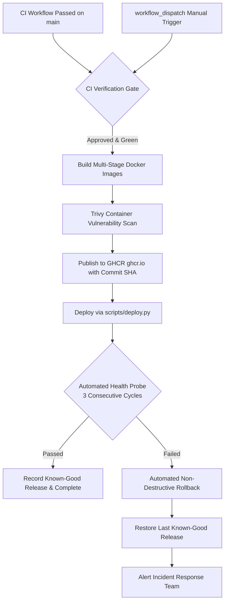

# SentinelOps AI — Continuous Deployment (CD) Architecture

## 1. Overview & Architecture

SentinelOps AI implements automated, gate-protected Continuous Deployment (Phase 6) via GitHub Actions (`.github/workflows/cd.yml`). The CD pipeline triggers automatically upon the successful completion of the Continuous Integration (CI) pipeline on the `main` branch, or on-demand via `workflow_dispatch`.



---

## 2. Container Registry & Image Strategy

### 2.1 Registry Configuration
Container images are hosted on **GitHub Container Registry (GHCR)** at `ghcr.io`.
- Authentication in CI/CD is provisioned automatically through the ephemeral `GITHUB_TOKEN` with `packages: write` permissions, eliminating external secret management overhead.

### 2.2 Image Tagging Policy
SentinelOps AI strictly prohibits using `latest` as the sole deployment identifier. Images are tagged with:
1. **Exact Commit SHA (Primary)**: `ghcr.io/<repo>/backend:<short_sha>` (e.g. `ghcr.io/venu5198/sentinelops-ai/backend:d77891d`)
2. **Environment Channel**: `ghcr.io/<repo>/backend:production` or `:staging`
3. **Semantic Release (if tagged)**: `ghcr.io/<repo>/backend:v1.0.0`

---

## 3. Deployment & Rollback Controller

The automated deployment lifecycle is orchestrated by [`scripts/deploy.py`](../scripts/deploy.py) and [`scripts/verify_deployment.py`](../scripts/verify_deployment.py).

### 3.1 Pre-Deployment Snapshot
Before pulling or restarting any container, the controller records the currently running images in `.last_known_good_deployment.json`.

### 3.2 Automated Health Verification
Post-deployment stability is determined across seven platform endpoints:
- **Frontend SPA**: `http://localhost:3000/` (HTTP 200)
- **Backend Health**: `http://localhost:8000/health` (HTTP 200)
- **Backend Readiness**: `http://localhost:8000/ready` (Verifies live MongoDB and Redis connectivity)
- **Payment Monitored Service**: `http://localhost:8080/health` (HTTP 200)
- **Order Monitored Service**: `http://localhost:8081/health` (HTTP 200)
- **Prometheus Server**: `http://localhost:9090/-/healthy` (HTTP 200)
- **Alertmanager Server**: `http://localhost:9093/-/healthy` (HTTP 200)

Verification requires **3 consecutive successful cycles** before declaring the deployment successful.

### 3.3 Automated Rollback Strategy
If any critical endpoint fails to respond with HTTP 200/healthy across the retry window:
1. The deployment controller halts forward progression.
2. An automated rollback event is logged.
3. The controller automatically restores the previous image tags recorded in `.last_known_good_deployment.json`.
4. Containers are recreated using the known-good images.
5. Post-rollback health probes verify that service is restored.
6. The GitHub Actions job exits with a failure code to notify engineers.

> [!IMPORTANT]
> **Non-Destructive Database Guarantee**: Rollbacks only recreate stateless application containers (`backend`, `frontend`). Database volumes (`mongodb_data`, `redis_data`) are never wiped or reset during automated rollback.

---

## 4. GitHub Actions Workflows & Environments

### 4.1 Automated Trigger
```yaml
on:
  workflow_run:
    workflows: ["SentinelOps AI Continuous Integration"]
    branches: [main]
    types: [completed]
```

### 4.2 Manual Deployment & Rollback (`workflow_dispatch`)
To trigger a deployment or rollback manually:
1. Navigate to **Actions** -> **SentinelOps AI Continuous Deployment**.
2. Click **Run workflow**.
3. Choose options:
   - **Target Deployment Environment**: `staging` or `production`.
   - **Deployment Action**: `deploy` or `rollback`.
   - **Target image tag/SHA**: Specify target SHA if rolling back to an older specific version.

### 4.3 Production Environment Protection
In GitHub Repository Settings -> **Environments**:
- Configure `production` environment with **Required reviewers**.
- Requires explicit lead approval before the `deploy` job executes.

---

## 5. Security & Isolation Controls

1. **Zero Secret Leaks**: No credentials, tokens, or private keys are exposed in workflow logs.
2. **Least Privilege**: Workflow runs with `contents: read`, `packages: write`, and `id-token: write`.
3. **Vulnerability Scanning**: Trivy scans container layers for CRITICAL/HIGH CVEs before release.
4. **Concurrency Guard**: `concurrency: group: cd-${{ inputs.environment || 'production' }}` with `cancel-in-progress: false` prevents overlapping deployments from conflicting.

---

## 6. Troubleshooting

| Symptom | Diagnostic Step | Remediation |
|---|---|---|
| Image pull failure (`401 Unauthorized`) | Check `ghcr.io` permissions | Ensure repository package visibility is configured or workflow has `packages: write`. |
| Post-deploy health probe timeout | Check backend container logs | `docker logs sentinelops-backend` to verify MongoDB/Redis connectivity. |
| Automatic rollback triggered | Inspect `deployment_events.log` | Review failed endpoint in step summary and resolve application regression before re-deploying. |
