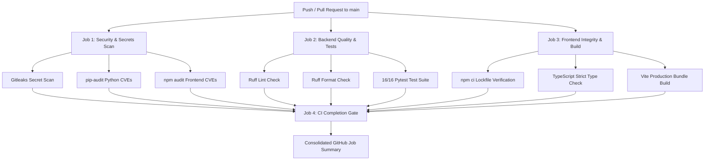

# SentinelOps AI — Continuous Integration (CI) Pipeline

## Overview
SentinelOps AI implements an enterprise-grade automated continuous integration workflow via GitHub Actions (`.github/workflows/ci.yml`). Every pull request and push to the `main` branch triggers parallel verification across security, backend testing, and frontend production packaging.

---

## 1. Pipeline Architecture

---

## 2. Job Breakdown

### Job 1: `security-scan` (Security & Vulnerability Scanning)
- **Gitleaks Secret Detection:** Scans all commits, diffs, and source trees for high-entropy tokens, API keys, credentials, and secrets using `gitleaks/gitleaks-action@v2`.
- **Python Dependency Audit:** Runs `pip-audit -r requirements.txt --desc` querying the PyPA advisory database for known CVEs.
- **Node Dependency Audit:** Evaluates frontend dependencies using `npm audit --prefix frontend --audit-level=high` against the GitHub Advisory Database.

### Job 2: `backend-ci` (Backend Quality & Test Suite)
- **Environment:** Ubuntu Linux, Python 3.12 with pip cache.
- **Linting & Formatting:** Enforces PEP 8, import sorting, and code cleanliness via `ruff check` and `ruff format --check`.
- **E2E Browser Automation:** Installs headless Chromium via `playwright install --with-deps chromium`.
- **Test Suite:** Executes 16 comprehensive unit, integration, RBAC, approval, remediation, and E2E journey tests under pytest with strict isolation (`USE_MOCK_DB=true`).

### Job 3: `frontend-ci` (Frontend Integrity & Build)
- **Environment:** Ubuntu Linux, Node.js 20.x with npm cache.
- **Lockfile Adherence:** Validates reproducible installations via clean `npm ci`.
- **Type Checking:** Runs strict TypeScript type checking via `npx tsc --noEmit`.
- **Production Compilation:** Builds optimized production bundles using `npm run build` (`dist/` asset packaging).

### Job 4: `ci-status-gate` (Quality Gate & Job Summaries)
- Aggregates status across all 3 parallel pipelines.
- Generates an executive Markdown table directly in `$GITHUB_STEP_SUMMARY`.
- Blocks merge if any security check, lint rule, test case, or build step fails.

---

## 3. Security & Safety Controls
1. **Least-Privilege Token Permissions:** Workflow is explicitly configured with `permissions: contents: read`.
2. **Secret Quarantining:** No secrets or credentials are logged or passed to untrusted environments.
3. **Infrastructure Isolation:** CI tests run against in-memory mock adapters (`mongomock-motor`, `fakeredis`, mocked Ollama diagnostic engine). Zero destructive commands or real cluster actions are executed in CI.
4. **Action Pinning:** All GitHub Actions use pinned major versions (`@v4`, `@v5`, `@v2`).

