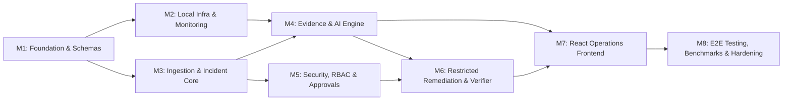

# SentinelOps AI — Implementation Roadmap & Execution Plan

**Document Version:** 1.0  
**PRD Reference:** Notion PRD v1.0 Section 14 (Epics 1–10), Section 15 (Milestones M1–M8)  
**Status:** Approved  

---

## 1. Delivery Milestones & Critical Path

---

## 2. Milestone Breakdown & Exit Criteria

### Milestone 1 (M1): Foundation, Data Schemas & Architecture
* **Focus:** Repository setup, FastAPI scaffolding, MongoDB schemas, Redis, health checks, correlation logging, and Git hygiene.
* **Tasks Covered:** TASK-001 to TASK-007.
* **Exit Criteria:**
  - `git status` clean on `main` branch with remote origin linked.
  - FastAPI server starts locally with `/health` and `/ready` endpoints returning HTTP 200.
  - MongoDB async client successfully connects and builds collection indexes.
  - Structured JSON logging with `correlation_id` middleware verified via Pytest.

### Milestone 2 (M2): Infrastructure, Monitoring & Monitored Services
* **Focus:** Docker Compose environment, Prometheus metrics, Loki log streaming, Alertmanager routing, and sample monitored service (`payment-service`).
* **Tasks Covered:** TASK-008 to TASK-013.
* **Exit Criteria:**
  - Docker Compose starts Prometheus, Alertmanager, Loki, MongoDB, Redis, and sample payment service.
  - Payment service exposes `/health`, `/metrics`, and `/simulate-failure` endpoints.
  - Alertmanager successfully dispatches webhook payloads upon triggered alert rules.

### Milestone 3 (M3): Ingestion, Deduplication & Incident Management Core
* **Focus:** Webhook ingestion API, payload validation, fingerprinting, deduplication, state machine transitions, incident queries and filters.
* **Tasks Covered:** TASK-014 to TASK-020.
* **Exit Criteria:**
  - Valid Alertmanager webhook creates an incident in state `DETECTED`.
  - Duplicate alerts within active window increment count without creating duplicate incidents.
  - Invalid state transitions return HTTP 400 with descriptive error message.

### Milestone 4 (M4): Evidence Collection & AI Investigation Engine
* **Focus:** Prometheus/Loki query adapters, telemetry normalization, Ollama local LLM integration, prompt sanitization, structured Pydantic report validation.
* **Tasks Covered:** TASK-021 to TASK-034.
* **Exit Criteria:**
  - Multi-source evidence gathered for incident time window.
  - Ollama client produces schema-compliant JSON diagnosis citing actual evidence IDs.
  - Graceful degradation verified when Ollama is offline (manual triage fallback).

### Milestone 5 (M5): Authentication, RBAC & Human Approval Workflows
* **Focus:** JWT bearer authentication, Bcrypt password hashing, Admin/Operator/Viewer roles, approval lifecycle, exact-action signature binding, expiration TTL.
* **Tasks Covered:** TASK-035 to TASK-041.
* **Exit Criteria:**
  - Protected endpoints reject unauthenticated requests with HTTP 401.
  - Viewers attempting approval receive HTTP 403.
  - Approvals sign exact action parameters with 15-minute expiration timestamp.

### Milestone 6 (M6): Restricted Remediation Execution & Recovery Verification
* **Focus:** Hardcoded action allowlist, parameter schema validation, Docker SDK container restart adapter, Redis execution lock, post-remediation health verification poller.
* **Tasks Covered:** TASK-042 to TASK-049.
* **Exit Criteria:**
  - Arbitrary / unallowlisted actions rejected immediately with zero shell invocation.
  - Approved restart of `payment-service` executes successfully.
  - Verification engine polls `/health` 3 times; on success, incident transitions to `RESOLVED`.
  - Unsuccessful remediation leaves incident in `FAILED` state with escalation prompt.

### Milestone 7 (M7): Frontend Operations Dashboard
* **Focus:** React 18, TypeScript, Tailwind CSS, live service health overview, incident table, AI investigation viewer, interactive approval modal, audit journal.
* **Tasks Covered:** TASK-050 to TASK-058.
* **Exit Criteria:**
  - Frontend builds with zero TypeScript or ESLint errors.
  - User can log in, view fleet health, triage incidents, review AI diagnosis, and approve actions from the web UI.

### Milestone 8 (M8): Comprehensive Testing, Benchmarking & Production Delivery
* **Focus:** Pytest test suite, Playwright end-to-end tests, 8-scenario AI diagnostic benchmark, security scanning, documentation, reproducible demo.
* **Tasks Covered:** TASK-059 to TASK-076.
* **Exit Criteria:**
  - 100% of unit, integration, and security tests pass.
  - Playwright E2E test executes the full user journey: Login $\rightarrow$ Alert Ingestion $\rightarrow$ Investigation $\rightarrow$ Approval $\rightarrow$ Execution $\rightarrow$ Verification $\rightarrow$ Resolution.
  - AI evaluation benchmark scores $\ge 80\%$ on labeled test dataset.
  - Clean repository state pushed to GitHub.

---

## 3. Immediate First Implementation Milestone: Milestone 1 (M1)

### Concrete Action Items for M1:
1. **TASK-001 (Repository Structure):**
   - Initialize standardized project layout: `backend/`, `frontend/`, `docker/`, `docs/`, `tests/`.
   - Configure root `.gitignore`, `.env.example`, and package manifests (`requirements.txt`, `package.json`).
2. **TASK-002 (FastAPI Application Setup):**
   - Implement `backend/main.py` with CORS, correlation ID middleware, and exception handlers.
   - Configure `backend/core/config.py` using `pydantic-settings`.
3. **TASK-003 (Database Client & Schemas):**
   - Configure async Motor MongoDB client (`backend/db/mongodb.py`).
   - Define data schemas and index creation scripts for all 8 collections.
4. **TASK-004 (Redis Coordination Client):**
   - Implement async Redis connection manager (`backend/db/redis.py`).
5. **TASK-006 & TASK-007 (Health & Structured Logging):**
   - Add `/health` and `/ready` endpoints verifying DB and cache connectivity.
   - Configure JSON structured logging with request correlation IDs.
6. **M1 Test Gate:**
   - Execute Pytest verifying DB connectivity, configuration loading, and health check endpoints.

