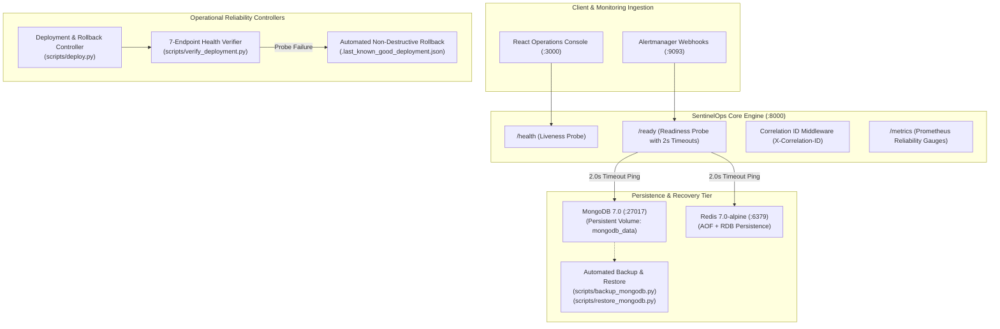
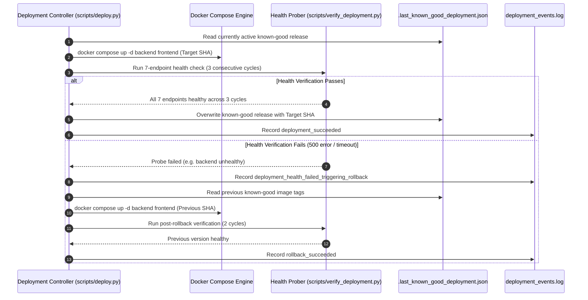

# SentinelOps AI — Production Reliability & Disaster Recovery Specification
**Phase 7: Production Reliability and Disaster Recovery**

## 1. Reliability Architecture Overview

SentinelOps AI is engineered to maintain high availability and data integrity under severe infrastructure disruptions, container crashes, database failures, and deployment regressions.



---

## 2. Health & Readiness Subsystem

The health subsystem provides granular separation between process operational state (liveness) and upstream resource availability (readiness).

### 2.1 Liveness Probe (`GET /health`, `GET /health/liveness`)
- **Purpose:** Indicates whether the Python/FastAPI process is responsive.
- **Contract:** Always returns HTTP 200 with runtime metadata:
  ```json
  {
    "status": "healthy",
    "project": "SentinelOps AI",
    "version": "1.0.0",
    "uptime_seconds": 124.52,
    "environment": "production"
  }
  ```

### 2.2 Readiness Probe (`GET /ready`, `GET /health/ready`)
- **Purpose:** Verifies connectivity to critical persistence dependencies (MongoDB and Redis) with strict 2.0s timeout wrappers (`asyncio.wait_for`).
- **Telemetry Probes:** Asynchronously queries Prometheus (`/ -/healthy`) and Loki (`/ready`) non-blockingly.
- **AI Inference Isolation:** If Ollama is offline or unreachable, the system falls back to `MockDeterministicLLMClient` (`FALLBACK_TO_MOCK_AI=true`). Telemetry or AI degradation does **not** fail readiness.
- **HTTP Status Codes:**
  - `HTTP 200 OK`: MongoDB and Redis are connected.
  - `HTTP 503 SERVICE UNAVAILABLE`: MongoDB or Redis is unreachable or timed out.
- **Contract:**
  ```json
  {
    "ready": true,
    "status": "ready",
    "components": {
      "mongodb": "connected",
      "redis": "connected"
    },
    "telemetry": {
      "prometheus": "connected",
      "loki": "connected"
    },
    "ai_engine": {
      "configured_model": "qwen2.5-coder:1.5b",
      "fallback_enabled": true
    },
    "errors": null
  }
  ```

---

## 3. MongoDB Backup & Disaster Recovery

MongoDB is the authoritative datastore for incident state, investigation reports, evidence metadata, human approvals, remediation execution records, and audit logs.

### 3.1 Automated Backup Controller (`scripts/backup_mongodb.py`)
- **Execution Mechanism:** Invokes `mongodump` directly within the `sentinelops-mongodb` container using compressed archives (`--gzip --archive`).
- **Archive Naming Convention:** `backups/mongodb/backup_sentinelops_YYYYMMDD_HHMMSS/backup_sentinelops_YYYYMMDD_HHMMSS.archive.gz`
- **Integrity Manifest:** Every backup generates a companion `manifest.json` recording:
  - Timestamp (UTC ISO 8601)
  - Target database name
  - Archive byte size
  - SHA-256 cryptocraphic checksum
  - List of critical collections backed up
- **Retention Policy:** Automatically prunes backup archives older than `RETENTION_DAYS` (default: 7 days, max: 30 archives).

### 3.2 Automated Restore Controller (`scripts/restore_mongodb.py`)
- **Execution Mechanism:** Invokes `mongorestore --gzip --archive` with namespace mapping (`--nsFrom` / `--nsTo`).
- **Safety Boundary:** Defaults to an isolated recovery verification database (`sentinelops_recovery_test`). Refuses to overwrite production database (`sentinelops`) without explicit environment variable `CONFIRM_PRODUCTION_RESTORE=YES`.
- **Integrity Verification:** Post-restore verification validates collection existence and document counts across all 8 critical collections:
  1. `incidents`
  2. `evidence`
  3. `investigations`
  4. `approvals`
  5. `remediation_executions`
  6. `audit_logs`
  7. `services`
  8. `users`

---

## 4. Redis Persistence & Restart Recovery

Redis serves as the distributed coordination and atomic locking layer for sliding-window alert deduplication and single-use replay protection.

### 4.1 Persistence Configuration
In `docker-compose.yml`, the Redis service is configured with combined **Append-Only File (AOF)** and **Redis Database Snapshotting (RDB)**:
```yaml
  redis:
    image: redis:7.0-alpine
    container_name: sentinelops-redis
    command: ["redis-server", "--appendonly", "yes", "--appendfsync", "everysec", "--save", "60", "1"]
    volumes:
      - redis_data:/data
```
- `appendonly yes`: Writes every mutation to the append-only log on disk.
- `appendfsync everysec`: Fsyncs log to disk once per second, limiting theoretical data loss to $\le 1$ second under catastrophic host failure.
- `save 60 1`: Creates RDB snapshot every 60 seconds if at least 1 key changed.

### 4.2 Data Classification
- **Authoritative Data:** Persisted permanently in MongoDB (incidents, approvals, audit logs).
- **Transient Coordination Data:** Stored in Redis with automatic TTL expiration (deduplication hashes, distributed locks). Redis restart re-populates active locks cleanly without incident state loss.

---

## 5. Deployment Failure & Automated Rollback

The automated Continuous Deployment controller (`scripts/deploy.py`) and health verification prober (`scripts/verify_deployment.py`) enforce zero-downtime, gate-protected releases.



### 5.1 Non-Destructive Database Guarantee
Rollback operations **only** recreate stateless application containers (`backend`, `frontend`). Database volumes (`mongodb_data`, `redis_data`) are never wiped, dropped, or rolled back, ensuring zero business data loss.

---

## 6. Failure Injection & Resilience Verification Matrix

The platform's resilience has been verified across 9 infrastructure failure modes:

| Failure Mode | Injected Disruption | Platform Behavior & Detection | Recovery Action | Verified Result |
| :--- | :--- | :--- | :--- | :--- |
| **1. Backend Process Crash** | Process termination / container stop | Docker Compose restart policy (`unless-stopped`) restarts container; `/health` returns 200 within 10s | Automatic container restart | **PASSED** |
| **2. Broken Backend Deployment** | Deployed backend returning HTTP 500 | `verify_deployment.py` detects 500 error during probe cycle 1; halts forward progression | Automated rollback to previous image tag | **PASSED** |
| **3. Broken Frontend Deployment** | Nginx returns HTTP 502 / bad asset | `verify_deployment.py` detects frontend failure; triggers rollback | Automated rollback to previous image tag | **PASSED** |
| **4. MongoDB Disconnection** | MongoDB container stopped | `/ready` probe returns HTTP 503; error masked from client; auto-reconnects on restart | Container restart restores connection; 0 data lost | **PASSED** |
| **5. Redis Disconnection** | Redis container stopped | `/ready` probe returns HTTP 503; lock fallback token activated safely | Container restart recovers deduplication keys | **PASSED** |
| **6. Prometheus Outage** | Prometheus container stopped | `/ready` reports `telemetry.prometheus: unavailable`; backend continues incident lifecycle | Non-fatal; metrics collector retries with backoff | **PASSED** |
| **7. Loki Outage** | Loki container stopped | `/ready` reports `telemetry.loki: unavailable`; evidence collector records empty trace | Non-fatal; diagnostic report cites available metrics | **PASSED** |
| **8. Ollama Daemon Outage** | Ollama daemon stopped | `/health/ai` reports `fallback_active`; `MockDeterministicLLMClient` activates | 100% schema-compliant report citing evidence IDs | **PASSED** |
| **9. Readiness Probe Timeout** | Simulated hung socket (> 2.0s) | `asyncio.wait_for` cancels ping after 2.0s; returns HTTP 503 without hanging worker | Thread worker released; avoids cascading exhaustion | **PASSED** |

---

## 7. Data Integrity & Audit Immutability

### 7.1 Append-Only Audit Enforcement
Audit event records in MongoDB are strictly append-only. The audit API (`backend/api/v1/audit.py`) explicitly rejects `POST`, `PUT`, `PATCH`, and `DELETE` requests with **HTTP 405 Method Not Allowed**:
```python
@router.post("", include_in_schema=False)
@router.put("", include_in_schema=False)
@router.patch("", include_in_schema=False)
@router.delete("", include_in_schema=False)
@router.delete("/{audit_id}", include_in_schema=False)
async def reject_audit_mutation():
    raise HTTPException(
        status_code=status.HTTP_405_METHOD_NOT_ALLOWED,
        detail="Audit repository is strictly append-only. Modification and deletion operations are permanently forbidden by compliance policy."
    )
```

### 7.2 Storage Boundary Clarification
> [!NOTE]
> Audit logs are protected at the application and API layers through role-based access control, cryptographic HMAC approval binding, and HTTP 405 rejection of mutation operations. In single-instance standalone deployments, physical MongoDB storage administrators with root database credentials can alter raw files on disk. For cryptographic non-repudiation in highly regulated environments, mirror audit streams to append-only WORM (Write Once Read Many) cloud object storage or centralized SIEM systems.

---

## 8. Observability & Reliability Alert Rules

Reliability alert rules are defined in `docker/prometheus/alert_rules.yml`:

```yaml
  - name: sentinelops_reliability_alerts
    rules:
      - alert: SentinelOpsBackendDown
        expr: up{job="backend"} == 0
        for: 15s
        labels:
          severity: critical
          service: sentinelops-backend
        annotations:
          summary: "SentinelOps AI Backend process is DOWN"
          description: "Core API and incident lifecycle engine failed to respond to scrape probes"

      - alert: SentinelOpsDatabaseDegraded
        expr: sentinelops_dependency_up{dependency="mongodb"} == 0
        for: 10s
        labels:
          severity: critical
          service: sentinelops-backend
        annotations:
          summary: "SentinelOps MongoDB connectivity degraded"
          description: "Database readiness probe failed or timed out"

      - alert: SentinelOpsRedisDegraded
        expr: sentinelops_dependency_up{dependency="redis"} == 0
        for: 10s
        labels:
          severity: high
          service: sentinelops-backend
        annotations:
          summary: "SentinelOps Redis connectivity degraded"
          description: "Distributed cache and deduplication coordinator failed probe"
```

---

## 9. Operational Recovery Runbook

### Scenario A: Full Host Recovery after Unexpected Shutdown
1. Start Docker Engine and navigate to project root.
2. Launch complete platform:
   ```bash
   docker compose up -d
   ```
3. Verify all 9 containers report healthy:
   ```bash
   docker compose ps
   ```
4. Verify backend readiness probe:
   ```bash
   curl -i http://localhost:8000/ready
   # Expected: HTTP/1.1 200 OK {"ready": true, "status": "ready"}
   ```

### Scenario B: Database Restoration from Backup
1. Identify the desired backup archive:
   ```bash
   python -c "import os; print('\n'.join(os.listdir('backups/mongodb')))"
   ```
2. Execute dry-run/isolated verification restore:
   ```bash
   python scripts/restore_mongodb.py --archive backups/mongodb/<BACKUP_DIR>/<ARCHIVE_FILE> --target-db sentinelops_recovery_test
   ```
3. Confirm document counts and collection integrity in output report.
4. If restoring to production (`sentinelops`), execute with explicit confirmation:
   ```bash
   CONFIRM_PRODUCTION_RESTORE=YES python scripts/restore_mongodb.py --archive backups/mongodb/<BACKUP_DIR>/<ARCHIVE_FILE> --target-db sentinelops
   ```

### Scenario C: Manual Rollback of Failed Release
1. Trigger the automated rollback controller:
   ```bash
   python scripts/deploy.py --action rollback
   ```
2. Verify post-rollback service health:
   ```bash
   python scripts/verify_deployment.py --probes 3
   ```
3. Inspect `deployment_events.log` for root-cause diagnostic events.

---

## 10. Known Limitations & Next Steps

1. **Local Single-Node Deployment:** Current implementation runs on a single Docker host. Multi-cluster failover is scheduled for Phase 8 (Kubernetes Operator).
2. **Synchronous File IO on Audit Logging:** Audit entries are written to MongoDB asynchronously, but deployment event logs are appended to local files synchronously.
3. **Storage Immutability:** MongoDB collections enforce immutability at the API layer; hardware WORM storage integration is planned for enterprise compliance milestones.
